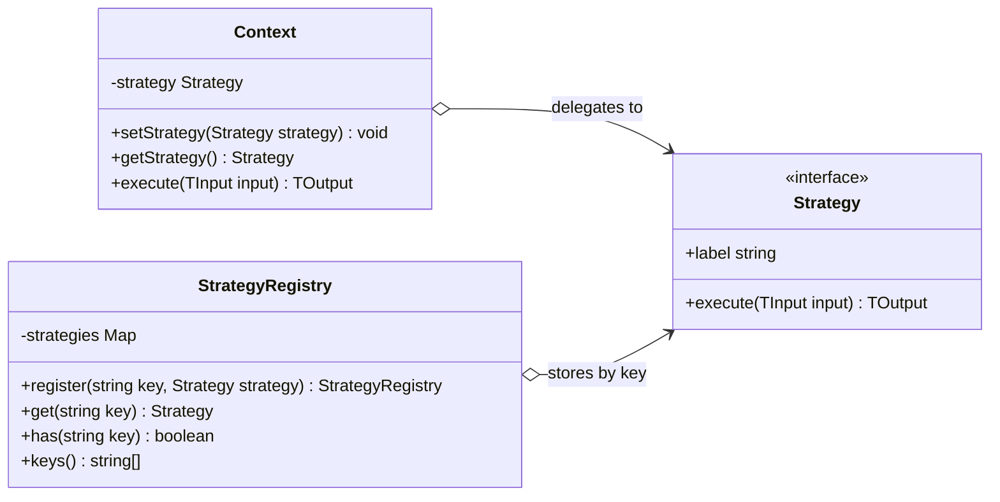
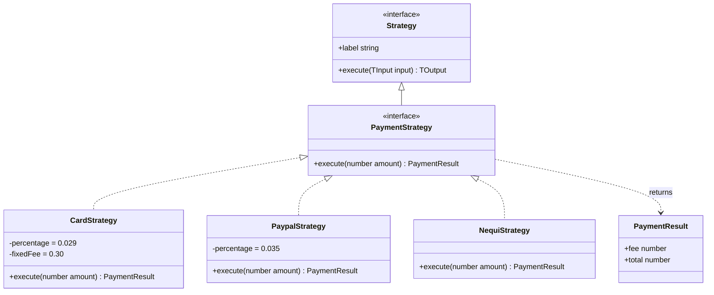
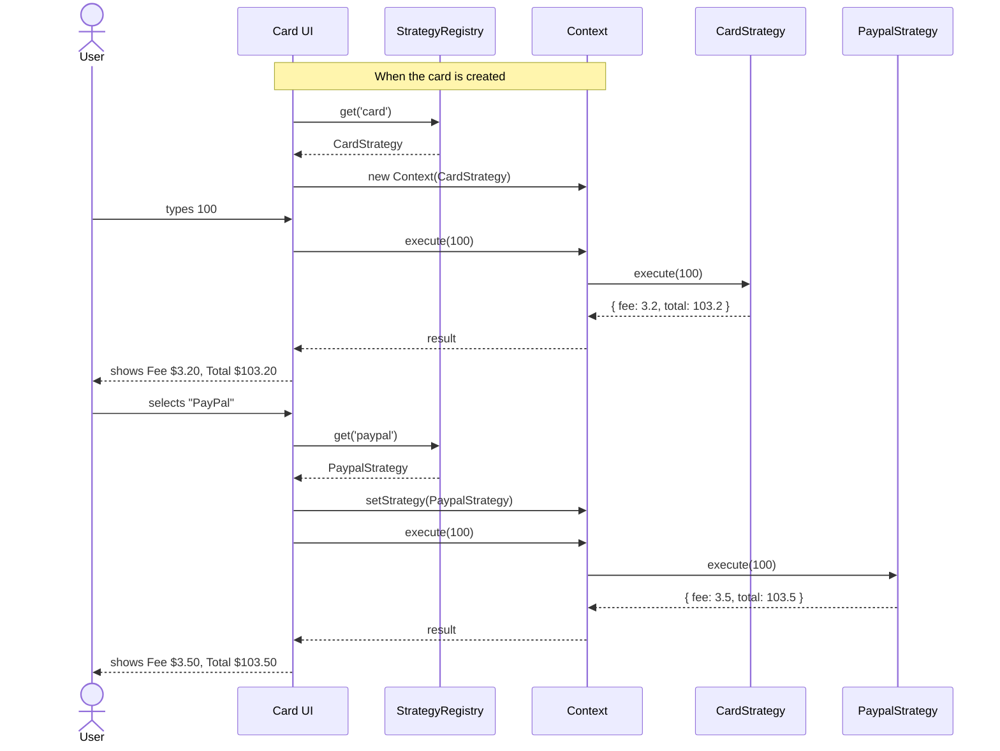
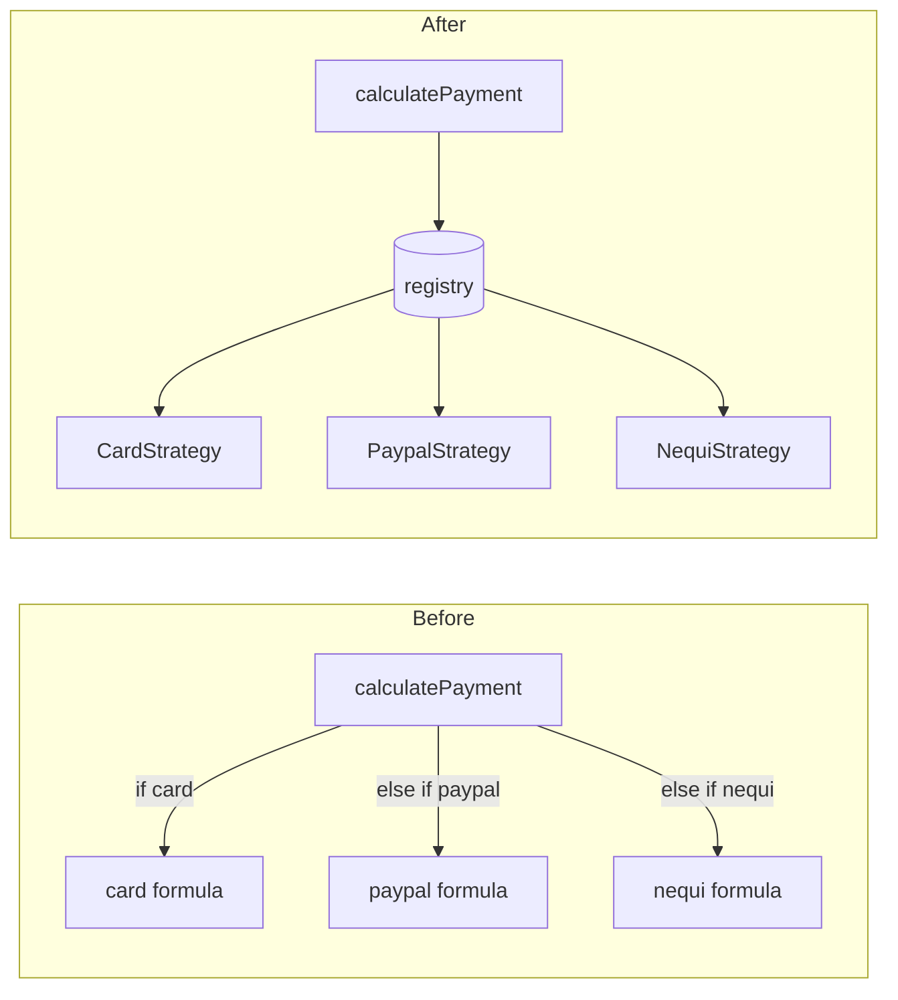

# Diagrams

GitHub renders these Mermaid diagrams automatically. In other viewers, paste them into [mermaid.live](https://mermaid.live).

## 1. The pattern (generic classes in `src/shared`)

- **Strategy** is the interface. **Context** holds one strategy and forwards `execute()` to it.
- **StrategyRegistry** is the lookup table the UI uses instead of `if/else`.

## 2. One domain: payment

Every other domain (`learning`, `gaming`, `healthcare`, `sorting`, `pricing`) has exactly the same shape: one interface, several concrete strategies, one result type.

## 3. Swapping a strategy at runtime (what each UI card does)

Notice that the **same Context object** is used before and after the swap. Only its strategy changed.

## 4. Before vs after: who knows about the payment methods?

Before, the function knows every method. After, it only knows the registry, and new methods plug in without changing it. See [before-after.md](before-after.md).
